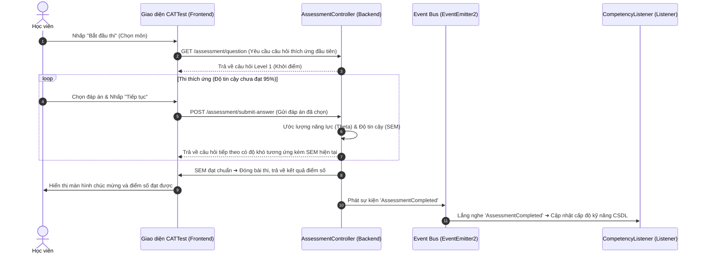

# 39. Interactive Workflows & UI Event Flow

Tài liệu này đặc tả luồng tương tác người dùng (Interactive Workflows) qua giao diện Front-end Next.js và cách đồng bộ dữ liệu bất đồng bộ với Backend NestJS qua hệ thống Event-Driven.

---

## 🔄 1. Luồng Nộp Bài Thi Thích Ứng (CAT Test Workflow)

---

## 📁 2. Luồng Nộp & Chấm Duyệt Minh Chứng (Evidence Workflow)

Luồng tương tác chính giữa Học viên và Giảng viên trong việc nộp và duyệt minh chứng học thuật:

1. **Học viên nộp bài**:
   - Học viên kéo thả file minh chứng vào `file-dropzone` ➜ Tải file lên Supabase Storage ➜ Nhận URL.
   - Học viên chọn năng lực DigComp bảo chứng (ví dụ: `1.1 Tìm kiếm thông tin`) ➜ Nhấn "Nộp minh chứng".
   - Frontend gọi API `POST /evidence/submit` ➜ Ghi nhận `Submission` vào CSDL ở trạng thái `score: null` ➜ Tạo bản ghi `EventLog` trạng thái `PENDING`.
2. **Giảng viên chấm bài**:
   - Giảng viên mở **Review Queue** ➜ Nhấp vào dòng bài nộp cần chấm ➜ Xem trước file PDF/Video.
   - Nhấn nút **"AI Gợi Ý"** ➜ Gọi API NestJS (Gemini AI Service) phân tích file ➜ Hiển thị gợi ý nhận xét.
   - Giảng viên điều chỉnh điểm số, nhập nhận xét ➜ Nhấp **"Phê Duyệt"** (Approve).
   - Frontend gọi API `POST /evidence/validate` ➜ Cập nhật `Submission` ➜ Tạo EventLog ➜ Phát sự kiện `EvidenceValidated` lên Event Bus.
   - `CompetencyListener` nhận sự kiện ➜ Đếm tổng số bài nộp đạt yêu cầu ➜ Đủ 3 bài tự động thăng cấp level kỹ năng học viên thêm 1 bậc ➜ Phát tiếp sự kiện `CompetencyUpdated`.

---

## 🔔 3. Luồng Cập Nhật Trạng Thái Giao Diện Bất Đồng Bộ

Để đảm bảo giao diện thay đổi mượt mà mà không cần người dùng tải lại trang (Reload):
- **Optimistic UI Updates (Cập nhật lạc quan)**: Khi học viên nhấp nộp minh chứng, dòng minh chứng lập tức xuất hiện trong danh sách Portfolio dưới dạng màu xám mờ kèm trạng thái "Đang chờ duyệt".
- **Realtime Notifications (Chuông báo động thời gian thực)**:
  - Khi `CompetencyUpdated` được phát đi từ listener, Notification Engine sẽ đẩy gói tin realtime xuống trình duyệt của học sinh (qua SSE hoặc WebSocket) ➜ Chuông báo động hiển thị chấm đỏ và hiện popup thông báo: *"Chúc mừng! Năng lực Tìm kiếm thông tin của bạn đã được thăng lên Level 3."*
  - Biểu đồ radar năng lực của học viên lập tức tự động vẽ lại theo tọa độ điểm mới.
