# BÁO CÁO ĐẶC TẢ VÀ KẾ HOẠCH TRIỂN KHAI DỰ ÁN THƯƠNG MẠI ĐIỆN TỬ
## ĐỀ TÀI: HỆ THỐNG ĐÁNH GIÁ VÀ CHỨNG NHẬN NĂNG LỰC SỐ THÍCH ỨNG DỰA TRÊN TRÍ TUỆ NHÂN TẠO (DIGVOS)

---

## I. Mục Tiêu

1. **Phân biệt mô hình Thương mại điện tử (TMĐT)**: Xác định rõ đặc trưng của các loại hình B2C, B2B, C2C, D2C; định vị chính xác mô hình kinh doanh kết hợp (B2B SaaS và B2C Edu-Marketplace) của dự án.
2. **Vận dụng quy trình triển khai**: Áp dụng quy trình 8 bước tiêu chuẩn của một dự án TMĐT vào bài toán xây dựng "Hệ thống đánh giá và chứng nhận năng lực số thích ứng dựa trên trí tuệ nhân tạo (DIGVOS)".
3. **Xác lập ý tưởng và mục tiêu theo chuẩn SMART**: Đánh giá tính khả thi kinh doanh của dự án qua 5 tiêu chí trọng yếu và thiết lập 3 mục tiêu định lượng cụ thể.

---

## II. Yêu Cầu Cần Đạt

1. **Lựa chọn ý tưởng chính thức**: Đề tài "Hệ thống đánh giá và chứng nhận năng lực số thích ứng dựa trên trí tuệ nhân tạo (DIGVOS)".
2. **Phiếu đánh giá ý tưởng hoàn chỉnh**: Chấm điểm và phân tích theo 5 tiêu chí: Nhu cầu thị trường, Tính khả thi kỹ thuật, Nguồn lực, Tính pháp lý, Lợi thế cạnh tranh.
3. **Sơ đồ Vòng đời dự án 5 giai đoạn**: Thiết lập tiến độ phân bổ chi tiết theo 15 tuần học tập và triển khai thực tế.
4. **Bộ 3 mục tiêu SMART**: Xây dựng đầy đủ các yếu tố Specific, Measurable, Achievable, Relevant, Time-bound cho các khía cạnh Kỹ thuật, Tăng trưởng người dùng và Doanh thu.

---

## III. Nội Dung Thực Hiện

---

### PHẦN 1: ÔN TẬP VÀ ĐỊNH HƯỚNG LÝ THUYẾT

#### 1. Khái Niệm Cốt Lõi Về Dự Án Và Dự Án Thương Mại Điện Tử

* **Dự án là gì?**: Dự án là một nỗ lực tạm thời được thực hiện nhằm tạo ra một sản phẩm, dịch vụ hoặc kết quả duy nhất. Dự án có thời điểm bắt đầu và kết thúc xác định, có giới hạn về phạm vi, ngân sách và nguồn lực.
* **Các loại dự án phổ biến**: Dự án xây dựng, dự án nghiên cứu phát triển (R&D), dự án chuyển đổi số, dự án công nghệ thông tin, dự án kinh doanh/thương mại.
* **Dự án Thương mại điện tử là gì?**: Là dự án ứng dụng công nghệ thông tin, viễn thông và internet nhằm thiết lập các nền tảng trực tuyến phục vụ cho quá trình giao dịch, mua bán sản phẩm/dịch vụ số hoặc vật lý, trao đổi giá trị và chăm sóc khách hàng trên môi trường số.

#### 2. Ba Đặc Thù Của Dự Án TMĐT So Với Dự Án Truyền Thống

* **Tốc độ thay đổi nhanh**: Công nghệ nền tảng, thuật toán tìm kiếm, xu hướng hành vi và các công cụ thanh toán/AI biến đổi liên tục, đòi hỏi phương pháp quản trị linh hoạt (Agile/Scrum).
* **Phụ thuộc vào hành vi người dùng số**: Trải nghiệm giao diện (UI), trải nghiệm người dùng (UX), độ trễ tải trang và mức độ thuận tiện trong thanh toán quyết định trực tiếp đến tỷ lệ chuyển đổi.
* **Tích hợp đa kênh và đa hệ thống số**: Đòi hỏi sự kết nối phức tạp giữa cổng thanh toán, đơn vị vận chuyển/lưu trữ đám mây, hệ thống xác thực danh tính, cơ chế bảo mật và phân tích dữ liệu lớn.

#### 3. Quy Trình 8 Bước Triển Khai Dự Án TMĐT Tiêu Chuẩn

```text
[Bước 1: Nhận diện cơ hội thị trường] 
   └──> [Bước 2: Xác định ý tưởng & Mô hình kinh doanh]
          └──> [Bước 3: Lập kế hoạch dự án & Ngân sách]
                 └──> [Bước 4: Thiết kế kiến trúc & Trải nghiệm (UI/UX)]
                        └──> [Bước 5: Lập trình phát triển hệ thống]
                               └──> [Bước 6: Kiểm thử & Đảm bảo chất lượng (QA/QC)]
                                      └──> [Bước 7: Triển khai vận hành (Go-Live) & Marketing]
                                             └──> [Bước 8: Đánh giá, Bảo trì & Mở rộng quy mô]
```

#### 4. Phân Tích Bảng So Sánh 4 Mô Hình TMĐT Phổ Biến Tại Việt Nam Và Định Vị DIGVOS

| Tiêu Chí So Sánh | B2C (Business to Consumer) | B2B (Business to Business) | C2C (Consumer to Consumer) | D2C (Direct to Consumer) | **Định Vị DIGVOS** |
| :--- | :--- | :--- | :--- | :--- | :--- |
| **Đối tượng giao dịch** | Doanh nghiệp bán cho Người tiêu dùng cá nhân | Doanh nghiệp bán cho Doanh nghiệp | Cá nhân bán cho Cá nhân | Nhà sản xuất bán trực tiếp cho Người tiêu dùng | **Doanh nghiệp bán cho Trường học/Doanh nghiệp (B2B SaaS) + Bán bài thi/chứng chỉ cho Người học (B2C)** |
| **Giá trị đơn hàng** | Nhỏ đến trung bình | Lớn, thanh toán theo kỳ/hợp đồng | Nhỏ, phụ thuộc thỏa thuận | Trung bình | **Gói thuê SaaS định kỳ (B2B) + Phí khảo thí cá nhân (B2C)** |
| **Chu kỳ ra quyết định** | Ngắn, theo cảm xúc/nhu cầu tức thì | Dài, qua nhiều cấp phê duyệt | Rất ngắn, mặc cả trực tiếp | Trung bình, dựa vào lòng tin thương hiệu | **B2B: 1-3 tháng đánh giá; B2C: Ra quyết định tức thì** |
| **Ví dụ điển hình tại Việt Nam** | Tiki, Shopee (gian hàng chính hãng) | KiotViet, Sapo, Haravan | Chợ Tốt, Facebook Marketplace | Coolmate, Juno | **DIGVOS Platform** |

---

### PHẦN 2: THỰC HÀNH XÂY DỰNG DỰ ÁN DIGVOS

#### 1. Ma Trận Đánh Giá 5 Ý Tưởng Sàng Lọc

| STT | Ý Tưởng TMĐT Đề Xuất | Nhu Cầu (1-5) | Tính Khả Thi Kỹ Thuật (1-5) | Nguồn Lực (1-5) | Pháp Lý (1-5) | Lợi Thế Cạnh Tranh (1-5) | Tổng Điểm | Kết Luận |
| :---: | :--- | :---: | :---: | :---: | :---: | :---: | :---: | :---: |
| 1 | Sàn thương mại điện tử mua bán đồ thủ công mỹ nghệ xuất khẩu | 3 | 4 | 2 | 3 | 2 | 14 | Loại |
| 2 | Nền tảng giao đồ ăn chuyên biệt cho ký túc xá sinh viên | 4 | 4 | 3 | 3 | 2 | 16 | Loại |
| 3 | **Hệ thống đánh giá và chứng nhận năng lực số thích ứng dựa trên trí tuệ nhân tạo (DIGVOS)** | **5** | **4** | **4** | **5** | **5** | **23** | **ĐƯỢC CHỌN** |
| 4 | Ứng dụng thanh lý giáo trình và thiết bị học tập cũ C2C | 4 | 4 | 3 | 4 | 2 | 17 | Loại |
| 5 | Trang web D2C bán phụ kiện thời trang thiết kế theo yêu cầu | 3 | 4 | 3 | 4 | 2 | 16 | Loại |

---

#### 2. Phiếu Đánh Giá Ý Tưởng Dự Án Chính Thức

| Hạng Mục | Nội Dung Đặc Tả |
| :--- | :--- |
| **Tên dự án** | **Hệ thống đánh giá và chứng nhận năng lực số thích ứng dựa trên trí tuệ nhân tạo (DIGVOS)** |
| **Mô tả dự án trong một câu** | Nền tảng TMĐT dịch vụ số (B2B/B2C SaaS) cung cấp giải pháp khảo thí thích ứng AI và cấp chứng chỉ năng lực số chuẩn hóa quốc tế được xác thực trên nền tảng Blockchain. |
| **Phân khúc khách hàng sơ bộ** | **1. Khách hàng B2B**: Các trường đại học, cao đẳng, trung tâm đào tạo và các doanh nghiệp có nhu cầu đánh giá/tuyển dụng nhân sự số.<br>**2. Khách hàng B2C**: Học sinh, sinh viên, người đi làm có nhu cầu đo lường năng lực số và sở hữu chứng chỉ chuẩn DigComp phục vụ xin việc. |
| **Vấn đề cần giải quyết** | 1. Tình trạng gian lận, làm giả bằng cấp chứng chỉ tin học truyền thống.<br>2. Các bài thi tin học hiện nay dài dòng, tốn kém nhưng không đo lường chính xác năng lực thực tế.<br>3. Doanh nghiệp mất nhiều chi phí và thời gian để thẩm định lại kỹ năng số của ứng viên. |
| **Giải pháp đề xuất** | 1. Ứng dụng mô hình AI CAT (Computerized Adaptive Testing) để rút ngắn 70% thời lượng làm bài mà vẫn đảm bảo độ chính xác tuyệt đối.<br>2. Cấp phát chứng chỉ số Soulbound Token (ERC-5192) gắn liền định danh trên Blockchain, xác thực tức thì qua mã QR.<br>3. Cung cấp sàn kết nối việc làm thông minh dựa trên độ khớp năng lực thực tế. |

---

#### 3. Phân Tích 5 Tiêu Chí Đánh Giá Ý Tưởng Dự Án DIGVOS

1. **Nhu cầu thị trường (Market Demand)**: 
   Quyết định số 749/QĐ-TTg của Thủ tướng Chính phủ về "Chương trình Chuyển đổi số quốc gia đến năm 2025, định hướng đến năm 2030" đặt mục tiêu phổ cập kỹ năng số cho toàn dân. Thị trường chứng chỉ số và công nghệ giáo dục (EdTech) tại Việt Nam đang tăng trưởng hơn 20%/năm, tạo ra khoảng trống lớn cho một nền tảng đánh giá chuẩn quốc tế.
2. **Tính khả thi kỹ thuật (Technical Feasibility)**: 
   Hệ thống xây dựng trên kiến trúc Monorepo tiên tiến (Next.js 15, NestJS 10, PostgreSQL/Prisma, Redis và Smart Contracts Solidity). Đội ngũ có khả năng tự chủ toàn bộ mã nguồn và giải thuật phân tích tham số Theta (IRT).
3. **Nguồn lực thực hiện (Resources)**: 
   Tận dụng các công nghệ mã nguồn mở hàng đầu, hạ tầng đám mây tối ưu chi phí (Docker, Vercel, Supabase, Cloudflare) giúp giảm thiểu vốn đầu tư ban đầu, tập trung năng lực vào hoàn thiện giải thuật lõi.
4. **Tính pháp lý (Legal Compliance)**: 
   Tuân thủ nghiêm ngặt Luật An ninh mạng Việt Nam, Nghị định 13/2023/NĐ-CP về Bảo vệ dữ liệu cá nhân, áp dụng tiêu chuẩn bảo mật dữ liệu giáo dục và định danh số.
5. **Lợi thế cạnh tranh (Competitive Advantage)**: 
   Tiên phong áp dụng Khung chuẩn năng lực DigComp 2.2/3.0 kết hợp bài thi thích ứng thông minh và chứng chỉ số Blockchain không thể làm giả.

---

#### 4. Sơ Đồ Vòng Đời Dự Án 5 Giai Đoạn (Project Lifecycle)

```mermaid
gantt
    title Kế Hoạch 12 Tuần Triển Khai Dự Án DIGVOS
    dateFormat  WW
    axisFormat  Tuần %W
    section GĐ 1: Khởi Tạo
    Nghiên cứu thị trường & Đóng băng yêu cầu :active, 01, 2w
    section GĐ 2: Lập Kế Hoạch
    Thiết kế kiến trúc hệ thống & DB Schema    :03, 2w
    section GĐ 3: Phát Triển
    Lập trình Backend NestJS & Frontend Web   :05, 4w
    section GĐ 4: Kiểm Thử
    Kiểm thử chức năng & Thử nghiệm 300 user  :09, 2w
    section GĐ 5: Bàn Giao
    Đánh giá CSAT, Báo cáo & Bàn giao nghiệm thu:11, 2w
```



* **Giai đoạn 1: Khởi tạo dự án (Tuần 1 – Tuần 2)**
  * Xác định phạm vi sản phẩm, phân tích khung DigComp 3.0 và khảo sát người học.
  * Hoàn thành đề cương dự án, phân bổ RACI 10 người và được phê duyệt.
* **Giai đoạn 2: Lập kế hoạch và Thiết kế (Tuần 3 – Tuần 4)**
  * Thiết kế kiến trúc Database 13 phân vùng dữ liệu và bộ API Contract.
  * Thiết kế toàn bộ hệ thống giao diện 4 nhóm Dashboard và Design System trên Figma.
* **Giai đoạn 3: Thực thi và Phát triển (Tuần 5 – Tuần 8)**
  * Lập trình 17 module Backend (NestJS) và giao diện người dùng (Next.js 15).
  * Tích hợp công cụ khảo thí CAT (IRT Theta) và Hợp đồng thông minh Blockchain ERC-5192.
* **Giai đoạn 4: Kiểm thử và Thử nghiệm thực tế (Tuần 9 – Tuần 10)**
  * Kiểm thử chức năng, bảo mật dữ liệu multi-tenant và tối ưu Core Web Vitals.
  * Chạy chiến dịch Marketing kéo 300 sinh viên tham gia đợt thi trực tuyến và cấp chứng chỉ số on-chain.
* **Giai đoạn 5: Đóng dự án và Đánh giá (Tuần 11 – Tuần 12)**
  * Khảo sát mức độ hài lòng người học (CSAT >= 85%), phân tích phổ điểm DigComp.
  * Tổng hợp báo cáo đánh giá thương mại hóa, xuất bản tài liệu và bảo vệ nghiệm thu trước hội đồng.

---

#### 5. Ba Mục Tiêu SMART Của Dự Án DIGVOS

##### Mục Tiêu 1: Hoàn Thiện Nền Tảng Kỹ Thuật Và Khảo Thí (Product & Quality)
* **S (Specific)**: Hoàn thành 100% các chức năng cốt lõi bao gồm: Hệ thống xác thực đa vai trò, bộ bài thi thích ứng CAT đo lường 8 cấp độ DigComp và hợp đồng cấp chứng chỉ số ERC-5192 trên mạng thử nghiệm.
* **M (Measurable)**: Đạt điểm hiệu năng Lighthouse >= 90 điểm, thời gian phản hồi API < 200ms, tỷ lệ câu hỏi đo lường hội tụ năng lực sau tối đa 20 câu hỏi/bài test.
* **A (Achievable)**: Khả thi dựa trên nền tảng công nghệ hiện đại Next.js 15, NestJS 10 và hạ tầng Docker/Redis sẵn có.
* **R (Relevant)**: Đóng vai trò là nền tảng cốt lõi quyết định tính chính xác và uy tín của hệ thống khảo thí.
* **T (Time-bound)**: Hoàn thành nghiệm thu phiên bản MVP trước tuần thứ 8 của học kỳ.

##### Mục Tiêu 2: Thu Hút Người Dùng Thử Nghiệm Và Tổ Chức (User Acquisition)
* **S (Specific)**: Triển khai thử nghiệm nền tảng tại ít nhất 02 cơ sở đào tạo/khoa chuyên ngành để tổ chức đánh giá năng lực số cho sinh viên.
* **M (Measurable)**: Đạt tối thiểu 300 tài khoản sinh viên (Learner) đăng ký, hoàn thành ít nhất 500 lượt làm bài kiểm tra và cấp phát thành công 150 chứng chỉ số đầu tiên.
* **A (Achievable)**: Phối hợp trực tiếp với các lớp học phần Tin học đại cương/Thương mại điện tử trong trường để triển khai thực tế.
* **R (Relevant)**: Tạo lập dữ liệu thực nghiệm để hiệu chỉnh tham số độ khó IRT và kiểm chứng giá trị thực tế của giải pháp.
* **T (Time-bound)**: Đạt được mốc số lượng người dùng trong giai đoạn Tuần 9 đến Tuần 10.

##### Mục Tiêu 3: Thương Mại Hóa Và Chỉ Số Kinh Doanh (Monetization & Validation)
* **S (Specific)**: Xác thực mô hình doanh thu thông qua việc đóng gói thành công 03 gói dịch vụ B2B SaaS (Standard, Pro, Enterprise) và tích hợp cổng thanh toán trực tuyến cho bài thi có thu phí.
* **M (Measurable)**: Thu thập ý kiến phản hồi đánh giá hài lòng từ người dùng đạt >= 85%, ký kết thỏa thuận ghi nhớ thử nghiệm (MOU) với ít nhất 01 doanh nghiệp tuyển dụng.
* **A (Achievable)**: Mức giá đề xuất cạnh tranh hơn 60% so với các kỳ thi chứng chỉ quốc tế truyền thống, mang lại lợi ích kinh tế rõ ràng cho nhà trường.
* **R (Relevant)**: Chứng minh tính bền vững tài chính và khả năng thương mại hóa thực tế của dự án sau khi kết thúc môn học.
* **T (Time-bound)**: Hoàn thành báo cáo đánh giá thương mại hóa tại Tuần 12.

---

### PHẦN 3: BÁO CÁO THUYẾT MINH Ý TƯỞNG VÀ GIẢI TRÌNH PHẢN BIỆN

#### 1. Báo Cáo Tóm Tắt Thuyết Minh Ý Tưởng Dự Án

Bảng tổng hợp nội dung thuyết minh cốt lõi của đề tài phục vụ công tác thẩm định và phê duyệt:

| Nội Dung Thuyết Minh | Chi Tiết Báo Cáo |
| :--- | :--- |
| **Bối cảnh và Tính cấp thiết** | Hiện trạng gian lận và làm giả chứng chỉ số ngày càng tinh vi; các bài thi tin học truyền thống có thời lượng kéo dài nhưng không phản ánh chính xác năng lực thực tế; doanh nghiệp tốn kém chi phí tái đào tạo và đánh giá lại ứng viên. |
| **Giải pháp Công nghệ Trọng tâm** | Ứng dụng giải thuật khảo thí thích ứng máy tính (CAT) theo mô hình lý thuyết đáp ứng câu hỏi (IRT) để tối ưu hóa bài thi; cấp chứng chỉ số định dạng Soulbound Token (ERC-5192) trên nền tảng Blockchain nhằm đảm bảo tính toàn vẹn và chống làm giả tuyệt đối. |
| **Mô hình Kinh doanh và Doanh thu** | Vận hành mô hình kết hợp B2B SaaS (thu phí định kỳ từ các cơ sở giáo dục, doanh nghiệp đào tạo) và B2C Edu-Marketplace (thu phí cấp chứng chỉ nâng cao và giao dịch tài nguyên giáo dục). |
| **Lộ trình Triển khai và Cam kết** | Hoàn thiện bản thử nghiệm MVP trước tuần thứ 8; tiến hành đánh giá thực nghiệm trên 300 người dùng tại 02 cơ sở đào tạo; hoàn tất nghiệm thu và báo cáo thương mại hóa tại tuần thứ 12. |

---

#### 2. Báo Cáo Giải Trình Phản Biện Theo 5 Tiêu Chí Đánh Giá

Dưới đây là nội dung giải trình chi tiết đối với các vấn đề phản biện trọng yếu của dự án:

| Tiêu Chí Đánh Giá | Vấn Đề Phản Biện Trọng Yếu | Nội Dung Báo Cáo Giải Trình |
| :--- | :--- | :--- |
| **1. Tính Khả Thi Kỹ Thuật** | Độ phức tạp của thuật toán khảo thí thích ứng (CAT) và việc tích hợp công nghệ Blockchain trong khung thời gian học phần. | Hệ thống đã hoàn thiện thiết kế kiến trúc phân tầng (Clean Architecture) và Database Schema 13 phân vùng dữ liệu. Module CAT được thiết kế độc lập dựa trên thư viện toán học chuẩn; Smart Contract sử dụng tiêu chuẩn mở ERC-5192 triển khai trên mạng thử nghiệm có chi phí giao dịch thấp, bảo đảm hoàn thành đúng tiến độ cam kết. |
| **2. Nhu Cầu Thị Trường** | Mức độ sẵn sàng đón nhận của các cơ sở giáo dục và người học đối với một chuẩn năng lực mới tại Việt Nam. | Quyết định 749/QĐ-TTg của Chính phủ đặt mục tiêu phổ cập kỹ năng số toàn dân. Chuẩn DigComp 3.0 đang được Bộ Thông tin và Truyền thông định hướng tham chiếu. Dự án giải quyết trực tiếp bài toán thiếu hụt công cụ đo lường khách quan cho các trường đại học và cao đẳng. |
| **3. Cân Đối Nguồn Lực** | Nguy cơ bội chi ngân sách hạ tầng máy chủ đám mây và chi phí bản quyền công nghệ. | Dự án tối ưu hóa chi phí vận hành bằng cách sử dụng các nền tảng mã nguồn mở hàng đầu (Next.js, NestJS, PostgreSQL, Redis) và kiến trúc Serverless/Container (Docker, Cloudflare, Supabase), giúp duy trì chi phí cố định ở mức tối thiểu trong giai đoạn phát triển và thử nghiệm. |
| **4. Pháp Lý & Bảo Vệ Dữ Liệu** | Rủi ro pháp lý liên quan đến quyền riêng tư, định danh số và dữ liệu học tập của học sinh, sinh viên. | Hệ thống tuân thủ nghiêm ngặt Nghị định 13/2023/NĐ-CP về Bảo vệ dữ liệu cá nhân và Luật An ninh mạng. Dữ liệu giữa các tổ chức được cô lập tuyệt đối thông qua kiến trúc Multi-tenant Middleware; chỉ có mã băm (Hash) của chứng chỉ được lưu trữ công khai trên Blockchain, không để lộ thông tin định danh cá nhân. |
| **5. Lợi Thế Cạnh Tranh** | Khả năng cạnh tranh với các chứng chỉ tin học quốc tế lâu năm (như MOS, IC3) và các hệ thống LMS truyền thống. | DIGVOS sở hữu ba lợi thế vượt trội: (1) Tiết kiệm 70% thời gian làm bài nhờ AI CAT thích ứng; (2) Chi phí triển khai cho nhà trường thấp hơn 60% so với việc mua bản quyền bài thi quốc tế; (3) Cung cấp chứng chỉ số Blockchain có thể xác thực tức thì trên phạm vi toàn cầu mà không cần qua bên trung gian. |

---

#### 3. Kết Luận Phê Duyệt Ý Tưởng Và Định Hướng Triển Khai

Ý tưởng đề tài **"Hệ thống đánh giá và chứng nhận năng lực số thích ứng dựa trên trí tuệ nhân tạo (DIGVOS)"** đã đáp ứng toàn diện các tiêu chí đánh giá về mặt lý luận, công nghệ và tính khả thi thương mại. 

Các nguyên tắc quản trị bắt buộc xuyên suốt quá trình thực hành:
1. **Tuân thủ quy chuẩn kiến trúc**: Duy trì tính toàn vẹn của mô hình Monorepo, tính cô lập dữ liệu đa khách thuê (Multi-tenant) và chuẩn API Contract.
2. **Kỷ luật quản lý lỗi (Zero-Silent-Failure)**: Mọi sự cố phát sinh trong quá trình lập trình và thử nghiệm bắt buộc phải được ghi nhận và xử lý triệt để trong tài liệu theo dõi lỗi `ERRORS.md`.
3. **Đồng bộ hóa tài liệu**: Mọi điều chỉnh về logic nghiệp vụ hoặc cấu trúc dữ liệu phải được cập nhật đồng thời vào hệ thống tài liệu kỹ thuật trong thư mục `docs/`.

---

## IV. Kết Luận

Bản báo cáo này xác lập cơ sở lý luận, hồ sơ đặc tả yêu cầu và kế hoạch hành động chi tiết cho đề tài **"Hệ thống đánh giá và chứng nhận năng lực số thích ứng dựa trên trí tuệ nhân tạo (DIGVOS)"**. Toàn bộ các mốc giai đoạn trong sơ đồ vòng đời 12 tuần và 3 mục tiêu SMART đã cam kết sẽ là căn cứ pháp lý và kỹ thuật phục vụ việc giám sát, đánh giá chất lượng và nghiệm thu sản phẩm cuối kỳ.
