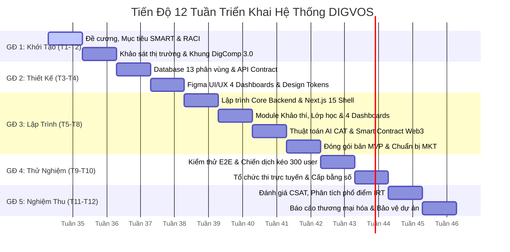

# KẾ HOẠCH TIẾN ĐỘ 12 TUẦN TRIỂN KHAI DỰ ÁN
## DỰ ÁN: HỆ THỐNG ĐÁNH GIÁ VÀ CHỨNG NHẬN NĂNG LỰC SỐ THÍCH ỨNG DỰA TRÊN TRÍ TUỆ NHÂN TẠO (DIGVOS)

---

## 1. Sơ Đồ Tiến Độ Tổng Thể 12 Tuần (Gantt Chart)



---

## 2. Bảng Phân Bổ Chi Tiết Công Việc Từng Tuần (Tuần 1 Đến Tuần 12)

| Tuần | Giai Đoạn | Đầu Mục Công Việc Trọng Tâm | Bộ Phận Phụ Trách Chính | Kết Quả Đầu Ra Bắt Buộc (Deliverables) |
| :---: | :--- | :--- | :---: | :--- |
| **Tuần 1** | **GĐ 1: Khởi Tạo** | - Thiết lập đề cương dự án, phân rã 3 mục tiêu SMART.<br>- Phân bổ 10 vị trí và ban hành ma trận RACI.<br>- Khởi tạo Monorepo (Turborepo, GitHub, Husky, CI/CD). | **PM, TECH LEAD** | Bản đề cương dự án; Repo mã nguồn Monorepo chuẩn; Bảng phân công RACI. |
| **Tuần 2** | **GĐ 1: Khởi Tạo** | - Khảo sát nhu cầu người học và tiêu chuẩn tuyển dụng.<br>- Phân tích và cấu trúc hóa khung DigComp 3.0 (5 miền, 21 tiêu chí).<br>- Lập kế hoạch tiếp thị số và nghiên cứu pháp lý (NĐ 13/2023/NĐ-CP). | **OPS, MARKETING, CUSTOMER** | Tài liệu đặc tả yêu cầu (SRS); Bộ từ điển dữ liệu DigComp 3.0; Kế hoạch MKT sơ bộ. |
| **Tuần 3** | **GĐ 2: Thiết Kế** | - Thiết kế Database Schema 13 phân vùng dữ liệu với Prisma ORM.<br>- Xây dựng bộ API Contract và Zod Validation Schemas.<br>- Thiết kế Wireframe giao diện 4 bảng điều khiển trên Figma. | **TECH LEAD, FE DEV** | File `schema.prisma` hoàn chỉnh; Bộ Type-safe DTOs; Bản vẽ Wireframe 4 Dashboards. |
| **Tuần 4** | **GĐ 2: Thiết Kế** | - Hoàn thiện giao diện UI/UX chi tiết 4 Dashboards trên Figma.<br>- Xây dựng gói Design System dùng chung (`packages/ui`).<br>- Biên soạn ngân hàng 300 câu hỏi mẫu và ma trận độ khó IRT. | **FE DEV, OPS** | Bản thiết kế Figma UI hoàn chỉnh; Thư viện `packages/ui`; File dữ liệu câu hỏi đợt 1. |
| **Tuần 5** | **GĐ 3: Lập Trình** | - Lập trình Backend Core (`identity`, `tenant`, `profiles`, `authorization`).<br>- Thiết lập cơ chế cô lập dữ liệu Multi-tenant Middleware.<br>- Dựng bộ khung Layout Next.js 15 App Router cho 4 phân hệ. | **TECH LEAD, BE DEV, FE DEV** | Module xác thực JWT/SSO hoạt động; Giao diện Shell Dashboard hiển thị đúng Role. |
| **Tuần 6** | **GĐ 3: Lập Trình** | - Lập trình module Lớp học (`workspace`), Nộp bài (`evidence`).<br>- Lập trình màn hình làm bài thi trắc nghiệm và biểu đồ Radar.<br>- Biên soạn thêm 200 câu hỏi nâng cao (Level 5 đến Level 8). | **BE DEV, FE DEV, OPS** | Luồng tạo lớp, thêm học sinh và làm bài kiểm tra tĩnh hoàn tất; Ngân hàng 500 câu. |
| **Tuần 7** | **GĐ 3: Lập Trình** | - Lập trình thuật toán khảo thí thích ứng CAT (tính Theta IRT).<br>- Xây dựng Worker BullMQ xử lý chấm bài tự luận qua AI.<br>- Viết và kiểm thử Smart Contract Soulbound Token (ERC-5192). | **AI & BLOCKCHAIN, BE DEV** | Module CAT ước lượng năng lực thời gian thực; Smart Contract deploy mạng testnet. |
| **Tuần 8** | **GĐ 3: Lập Trình** | - Tích hợp toàn diện Backend và Frontend thành bản thử nghiệm MVP.<br>- Xây dựng cổng xác thực chứng chỉ số công khai qua mã QR.<br>- Sản xuất bộ tài liệu, video truyền thông chuẩn bị tuyển sinh. | **TECH LEAD, MKT, CS** | Bản MVP hoàn chỉnh 100% chức năng lõi; Bộ tư liệu truyền thông sẵn sàng chạy. |
| **Tuần 9** | **GĐ 4: Thử Nghiệm** | - Kiểm thử tải (Load Testing), kiểm thử bảo mật và sửa lỗi (`ERRORS.md`).<br>- Khởi chạy chiến dịch tiếp thị số đa kênh kéo 300 sinh viên dự thi.<br>- Cấu hình Tenant cho 02 cơ sở đào tạo/khoa tham gia thử nghiệm. | **TECH LEAD, MKT, OPS** | Báo cáo kiểm thử QA; Danh sách 300 thí sinh đăng ký; Hạ tầng Tenant sẵn sàng. |
| **Tuần 10** | **GĐ 4: Thử Nghiệm** | - Tổ chức kỳ thi trực tuyến thử nghiệm tập trung cho sinh viên.<br>- Trực tổng đài hỗ trợ kỹ thuật phòng thi qua Livechat/Email.<br>- Tự động cấp phát chứng chỉ số Blockchain cho thí sinh đạt chuẩn. | **OPS, CS, TECH LEAD** | 500 lượt thi hoàn thành; 150 chứng chỉ số được đúc on-chain thành công. |
| **Tuần 11** | **GĐ 5: Nghiệm Thu** | - Thu thập khảo sát mức độ hài lòng người học (mục tiêu CSAT >= 85%).<br>- Phân tích phổ điểm và đánh giá độ chính xác của giải thuật CAT.<br>- Khắc phục các lỗi phát sinh (Hotfix) và tối ưu hóa hệ thống. | **CUSTOMER, OPS, TECH LEAD** | Báo cáo khảo sát người dùng; Báo cáo phân tích chất lượng đề thi và giải thuật. |
| **Tuần 12** | **GĐ 5: Nghiệm Thu** | - Tổng hợp báo cáo đánh giá thương mại hóa và 3 mục tiêu SMART.<br>- Hoàn tất đóng gói mã nguồn và xuất bản tài liệu hệ thống (`docs/`).<br>- Bảo vệ dự án trước hội đồng nghiệm thu/giảng viên hướng dẫn. | **PM, TOÀN ĐỘI NGŨ** | Bản báo cáo tổng kết dự án hoàn chỉnh; Bộ mã nguồn và hồ sơ nghiệm thu chính thức. |

---

## 3. Các Mốc Quan Trọng Bắt Buộc Hoàn Thành (Milestones)

```text
[Tuần 2: Đóng băng yêu cầu & Chuẩn DigComp]
   │
   ▼
[Tuần 4: Hoàn thành thiết kế UI/UX & DB Schema]
   │
   ▼
[Tuần 8: Hoàn tất bản thử nghiệm MVP (100% tính năng lõi)]
   │
   ▼
[Tuần 10: Tổ chức kỳ thi thử nghiệm 300 người dùng & Cấp bằng số]
   │
   ▼
[Tuần 12: Nghiệm thu toàn diện & Báo cáo thương mại hóa]
```

1. **Mốc 1 (Cuối Tuần 2) - Đóng băng yêu cầu**: Hoàn thành đề cương, phân bổ RACI 10 người và tài liệu đặc tả khung DigComp 3.0.
2. **Mốc 2 (Cuối Tuần 4) - Đóng băng thiết kế**: Hoàn thiện 100% thiết kế giao diện trên Figma và Database Schema 13 phân vùng.
3. **Mốc 3 (Cuối Tuần 8) - Hoàn thành MVP**: Hệ thống chạy thông suốt từ Đăng nhập -> Làm bài thi thích ứng AI CAT -> Chấm điểm -> Cấp chứng chỉ Blockchain.
4. **Mốc 4 (Cuối Tuần 10) - Kiểm chứng thực tế**: Đạt 300 người đăng ký, 500 lượt thi và đúc thành công 150 chứng chỉ số on-chain.
5. **Mốc 5 (Cuối Tuần 12) - Bàn giao & Nghiệm thu**: Hoàn thành toàn bộ báo cáo SMART, tài liệu `docs/` và bảo vệ thành công dự án.

---

## 4. Phân Bổ Nguồn Lực 10 Thành Viên Theo 5 Giai Đoạn

| Giai Đoạn | Khối Quản Trị (PM) | Khối Kỹ Thuật (TECH) | Khối Tiếp Thị (MKT) | Khối Vận Hành (OPS) | Khối CSKH (CUSTOMER) |
| :--- | :--- | :--- | :--- | :--- | :--- |
| **GĐ 1: Khởi Tạo (T1-T2)** | Lập kế hoạch, RACI | Khởi tạo Monorepo | Lập kế hoạch tiếp thị | Chuẩn hóa DigComp 3.0 | Khảo sát nhu cầu thị trường |
| **GĐ 2: Thiết Kế (T3-T4)** | Giám sát thiết kế | Thiết kế DB & Figma | Chuẩn bị Brand Assets | Soạn 300 câu hỏi IRT | Đóng góp trải nghiệm người dùng |
| **GĐ 3: Lập Trình (T5-T8)** | Kiểm soát Sprint MVP | Code 17 Module, CAT, Web3 | Sản xuất Content/Video | Nhập liệu ngân hàng đề | Chuẩn bị kịch bản hỗ trợ |
| **GĐ 4: Thử Nghiệm (T9-T10)** | Điều phối kỳ thi | Giám sát hạ tầng Cloud | Kéo 300 thí sinh dự thi | Vận hành phòng thi online | Trực hỗ trợ kỹ thuật trực tiếp |
| **GĐ 5: Nghiệm Thu (T11-T12)** | Báo cáo tổng kết dự án | Tối ưu hóa & Đóng gói | Báo cáo chi phí MKT/CAC | Báo cáo chất lượng đề | Khảo sát hài lòng CSAT >= 85% |
