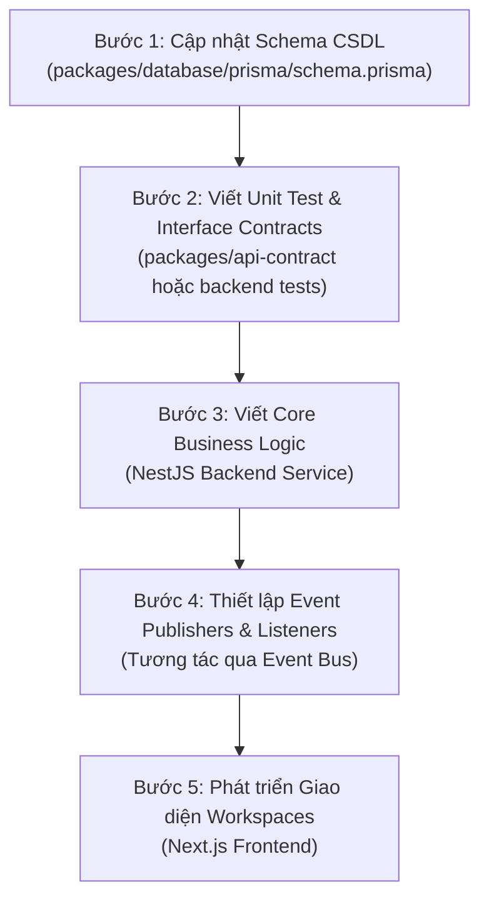

# DIGVOS - AI Agent Workflow

Tài liệu này định nghĩa quy trình làm việc (workflow) chuẩn dành riêng cho **AI Agent** (và nhà phát triển) khi thực hiện code các tính năng hoặc refactor hệ thống **DIGVOS**. Tuân thủ nghiêm ngặt quy trình này giúp AI Agent không tạo ra mã nguồn rác, lỗi kiến trúc hoặc phá vỡ các nguyên lý DDD.

---

## 1. Giao Thức Đọc Tài Liệu Trước Khi Code (Reading Protocol)

Trước khi chạm vào bất kỳ file code `.ts`, `.tsx`, `.sol` nào, AI Agent **BẮT BUỘC** phải đọc các tài liệu chỉ đường theo thứ tự sau:

```
[1. dependency_graph.md] ➜ Xem liên kết giữa các module để tránh import vòng.
          ↓
[2. build_order.md]      ➜ Xác định xem module định làm có đủ điều kiện tiền đề chưa.
          ↓
[3. architecture_diagrams.md] ➜ Xem sơ đồ C4 và luồng Event tương ứng.
          ↓
[4. docs/ chuyên biệt]    ➜ Đọc file docs chi tiết của module (Ví dụ: 07_ASSESSMENT_ENGINE.md).
```

---

## 2. Quy Trình Lập Trình 5 Bước (Surgical Coding Flow)

Khi được giao nhiệm vụ code một tính năng mới (Ví dụ: thêm logic chấm điểm CAT Test mới):



### Chi tiết các bước thực hiện:

1. **Bước 1: CSDL Trước Tiên (Schema-First)**:
   - Cập nhật Prisma Schema. Luôn bổ sung: `tenant_id`, `created_at`, `updated_at`, `deleted_at` (soft delete) cho các thực thể nghiệp vụ mới.
   - Chạy migration hoặc sinh client: `npm run build` ở root để đồng bộ Prisma Client.
2. **Bước 2: Hợp Đồng API & Test (Contract-First / TDD)**:
   - Định nghĩa DTOs, interfaces và API endpoints trong `packages/api-contract`.
   - Viết các test cases kiểm thử biên độ lỗi (edge cases) trước khi viết logic chạy thật.
3. **Bước 3: Hiện thực hóa logic nghiệp vụ (Service implementation)**:
   - Viết code dịch vụ ở NestJS backend. Đảm bảo logic tính toán năng lực nằm ở `CompetencyEngine`, logic làm bài nằm ở `AssessmentEngine`.
4. **Bước 4: Tách rời liên kết qua Event Bus (Decoupling)**:
   - Tuyệt đối không gọi trực tiếp API của module khác. Thay vào đó, gọi `EventBus.publish('TÊN_SỰ_KIỆN', dữ_liệu)`.
   - Viết các Class Listeners ở các module phụ thuộc để xử lý không đồng bộ.
5. **Bước 5: Ráp nối giao diện (Frontend Assembly)**:
   - Viết component giao diện ở `apps/web`. Sử dụng UI design tokens chuẩn, màu sắc cao cấp, và kết nối với Backend endpoints đã tạo.

---

## 3. Các Điều Cấm Kỵ Đối Với AI Agent (Strict Constraints)

> [!CAUTION]
> **1. KHÔNG hardcode API Keys hoặc địa chỉ ví Blockchain**: Luôn đọc từ `process.env`.
>
> **2. KHÔNG bypass ma trận phân quyền (Permissions)**: Mọi API endpoint mới bắt buộc phải đi qua decorator `@CheckPermissions(...)` hoặc middleware RBAC tương đương.
>
> **3. KHÔNG viết logic nghiệp vụ (business logic) ở Frontend**: Frontend Next.js chỉ có nhiệm vụ hiển thị dữ liệu (view), tương tác chuyển động (motion/visuals), và gọi API. Toàn bộ logic tính toán năng lực số, đối khớp tuyển dụng phải nằm ở Backend.
>
> **4. KHÔNG sử dụng Hard Delete**: Luôn sử dụng Soft Delete bằng cách cập nhật trường `deleted_at`.
