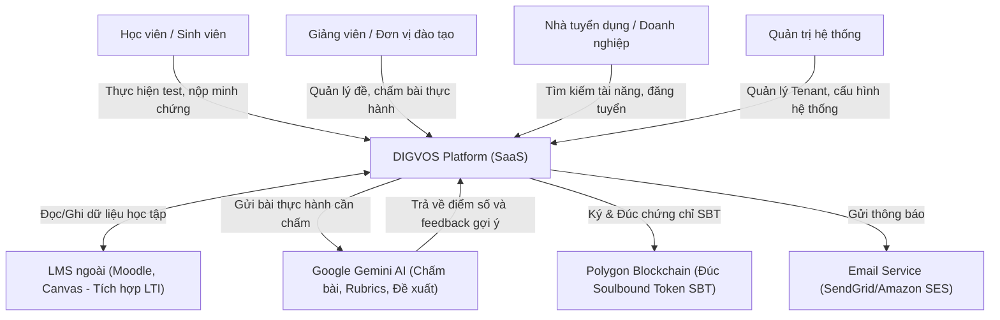
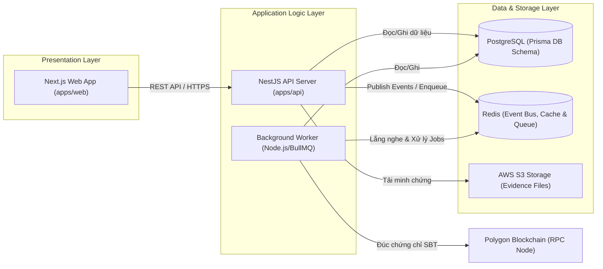
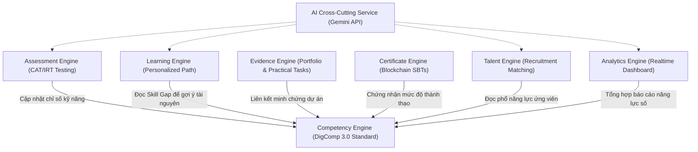
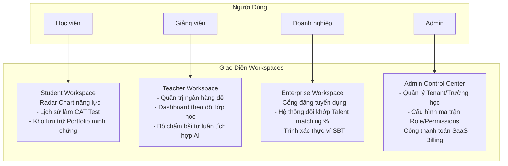
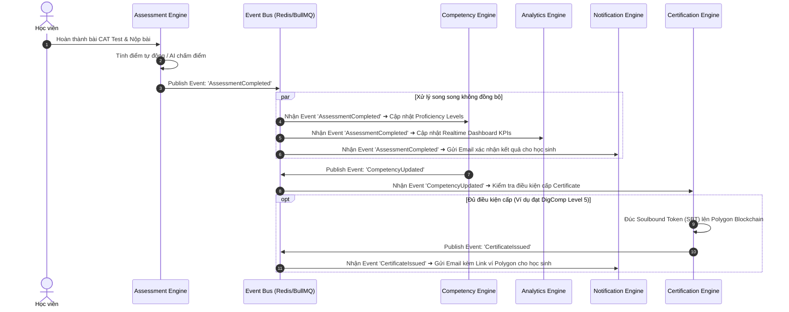

# DIGVOS - Architecture Diagrams

Tài liệu này chứa 5 sơ đồ kiến trúc Mermaid chi tiết, giúp AI Agent và nhà phát triển hình dung toàn cảnh hoạt động của hệ thống **DIGVOS** ở các lớp khác nhau (C4 Model & Event Flow).

---

## 1. System Context Diagram (Sơ đồ Ngữ cảnh Hệ thống)

Sơ đồ này mô tả cách người dùng và các dịch vụ bên ngoài tương tác với **DIGVOS**.

---

## 2. Container Diagram (Sơ đồ Container)

Mô tả cấu trúc Monorepo và cách các container ứng dụng tương tác vật lý.

---

## 3. Business Engine Diagram (Sơ đồ Động cơ Nghiệp vụ)

Thể hiện **Competency Engine** là trung tâm và các Business Engine liên kết gián tiếp thông qua nó. **AI** và **Identity** được cấu trúc ngoài business core.

---

## 4. Workspace Diagram (Sơ đồ Không gian Làm việc)

Thể hiện sự phân tách giao diện người dùng hoàn toàn độc lập cho 4 đối tượng.

---

## 5. Event Flow Diagram (Sơ đồ Luồng Sự kiện)

Mô tả luồng xử lý không đồng bộ (Event-Driven) giải phóng phụ thuộc cứng giữa các Engine.

