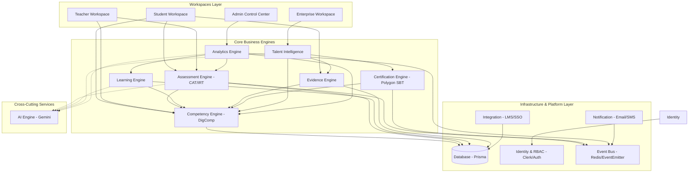

# DIGVOS - Dependency Graph

Tài liệu này đặc tả đồ thị phụ thuộc của hệ thống **DIGVOS** để định hướng cho AI Agent và nhà phát triển nắm được thứ tự liên kết giữa các module, tránh tình trạng phụ thuộc vòng (circular dependency) và xây dựng sai kiến trúc.

---

## 1. Bản Đồ Phụ Thuộc Tổng Thể (System Dependency Map)

---

## 2. Chi Tiết Quan Hệ Phụ Thuộc (Dependency Matrix)

| Module / Engine | Phụ thuộc trực tiếp vào | Loại quan hệ | Lý do phụ thuộc |
| :--- | :--- | :--- | :--- |
| **Competency Engine** | `Database (Prisma)` | Cương quyết (Hard) | Quản lý khung năng lực DigComp 3.0 và lưu trữ chỉ số thành thạo của từng cá nhân. |
| **Assessment Engine** | `Competency Engine` `Database` `Event Bus` | Cương quyết (Hard) Mềm (Event-driven) | Cần đọc Rubrics từ Competency. Khi hoàn thành bài test CAT, phát đi Event `AssessmentCompleted`. |
| **Learning Engine** | `Competency Engine` `Database` | Cương quyết (Hard) | Đề xuất tài nguyên học thuật dựa trên khoảng trống năng lực (Skill Gap) lấy từ Competency. |
| **Evidence Engine** | `Competency Engine` `Database` | Cương quyết (Hard) | Ánh xạ các dự án, chứng chỉ bên ngoài hoặc bài thực hành vào các vùng năng lực số tương ứng. |
| **Certification Engine**| `Competency Engine` `Event Bus` | Cương quyết (Hard) Mềm (Event-driven) | Lắng nghe Event đủ điều kiện cấp phát để ký duyệt đúc Soulbound Token (SBT) Polygon. |
| **Talent Intelligence** | `Competency Engine` `Evidence Engine` `Certification Engine` | Cương quyết (Hard) | Tổng hợp toàn bộ hồ sơ năng lực thực tế, minh chứng và chứng chỉ số để đối khớp % matching. |
| **Analytics Engine** | `Event Bus` | Mềm (Event-driven) | Nhận sự kiện từ tất cả các Engine để xây dựng biểu đồ phổ điểm, heatmap năng lực mà không truy vấn chéo CSDL. |
| **AI Engine (Service)** | *Không phụ thuộc Engine khác* | Cross-cutting | Là dịch vụ dùng chung cung cấp API phân tích cho Assessment, Learning, Matching và Analytics. |

---

## 3. Quy Tắc Tương Tác Giữa Các Domain (Domain Isolation Rules)

1. **Không gọi API trực tiếp giữa các Business Engine**:
   - Nghiêm cấm việc `AssessmentEngine` import trực tiếp `CertificationService`.
   - Mọi liên kết chéo bắt buộc phải đi qua **Event Bus** để giải phóng sự phụ thuộc (Decoupling).
2. **AI Engine độc lập hoàn toàn**:
   - AI Engine hoạt động như một tiện ích không trạng thái (stateless utility). Nó nhận dữ liệu đầu vào (Ví dụ: bài làm thực hành, Rubrics) và trả về kết quả phân tích (điểm số, feedback), không tự thay đổi trạng thái của database thuộc domain khác.
3. **Bản đồ năng lực (Competency) là Nguồn Chân Lý (Source of Truth)**:
   - Các Engine khác chỉ tác động gián tiếp đến Competency thông qua việc gửi kết quả đánh giá (Assessment) hoặc minh chứng (Evidence).
   - `StudentWorkspace` chỉ cần đọc dữ liệu từ `Competency Engine` để hiển thị biểu đồ Radar mà không cần truy vấn ngược lại xem câu hỏi thi nào đã tạo nên điểm số đó.
